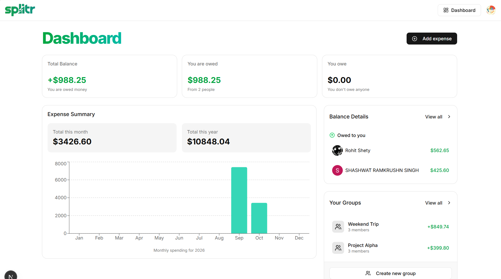
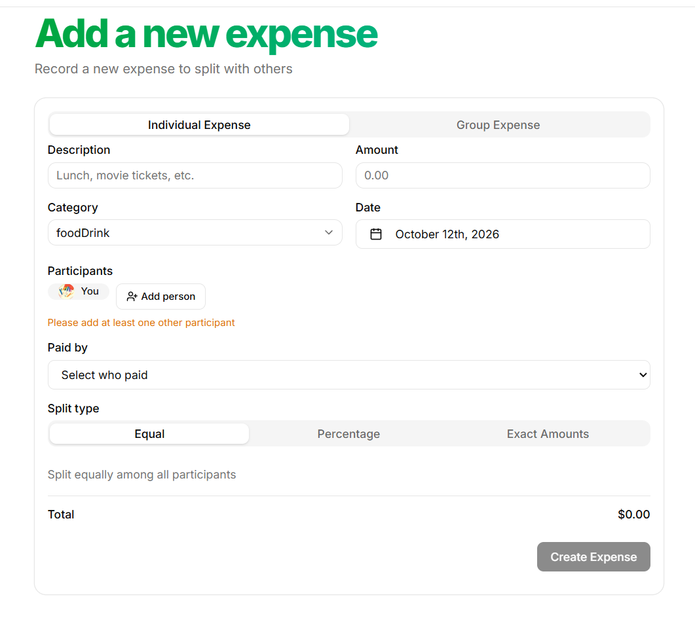
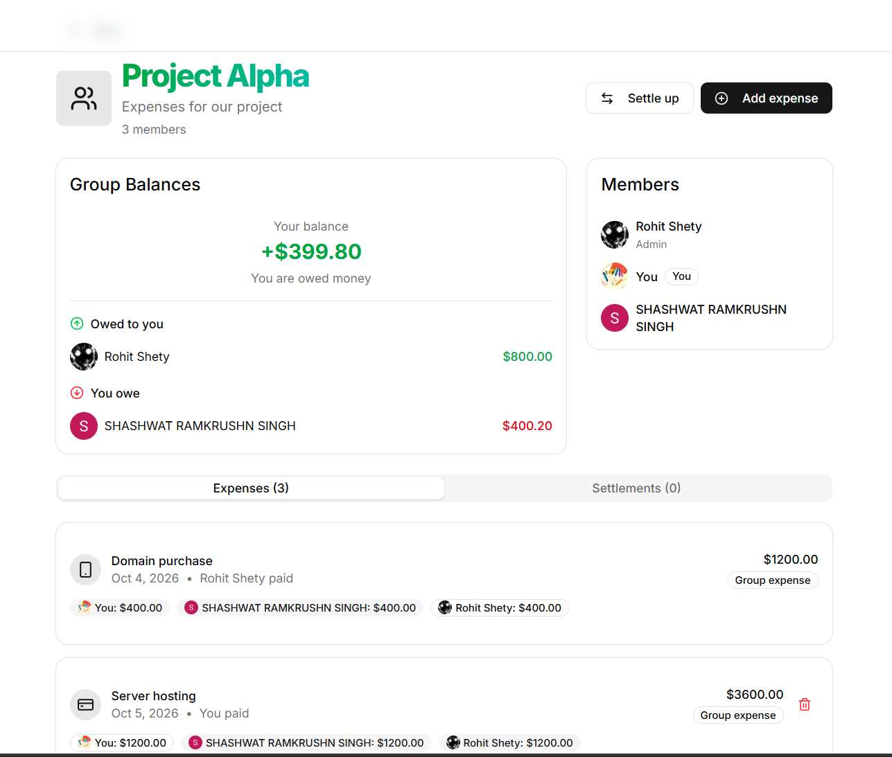
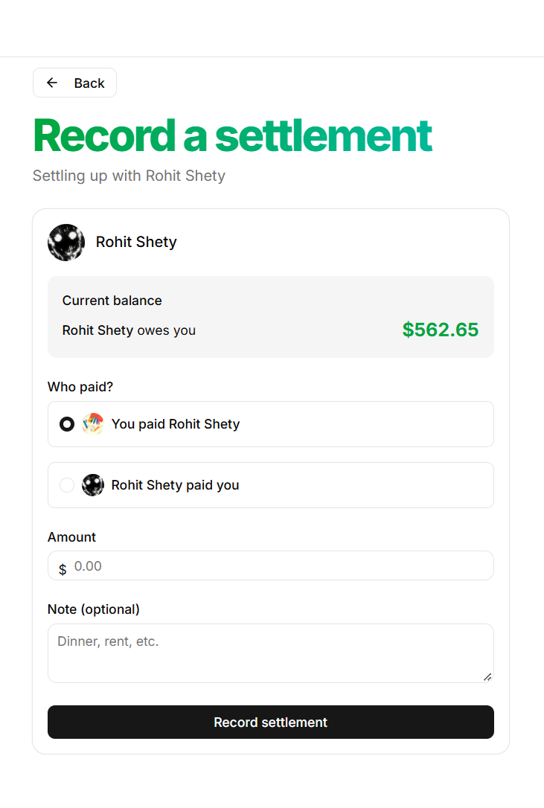
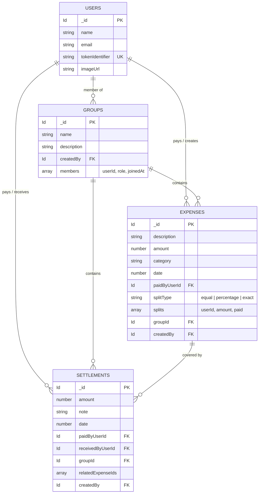

<div align="center">

  

  <h3>The Smartest Way to Split Expenses with Friends</h3>

  <p>
    Track shared expenses, split bills effortlessly, calculate pairwise debt ledgers, and settle up with real-time reactive sync and AI-powered financial insights.
  </p>

  <p>
    <a href="#-features">Features</a> •
    <a href="#-screenshots">Screenshots</a> •
    <a href="#-tech-stack">Tech Stack</a> •
    <a href="#-architecture">Architecture</a> •
    <a href="#-getting-started">Getting Started</a> •
    <a href="#-project-structure">Project Structure</a>
  </p>

  <p>
    <a href="https://spliter-umber.vercel.app" target="_blank">
      
    </a>
  </p>

  <p>
    
    
    
    
    
    
    
  </p>
</div>

---

## 📸 Screenshots Showcase

<!-- 
  TIP: Replace the placeholder image paths below with your actual application screenshots.
  Recommended location: public/screenshots/ (e.g. public/screenshots/dashboard.png)
-->

### 🌟 Application Overview
<div align="center">
  
  <p><em>Landing page & overview of Splitr</em></p>
</div>

<br />

### 🖼️ Feature Gallery

<table>
  <tr>
    <td width="50%" align="center">
      <h4>📊 Financial Dashboard & Analytics</h4>
      <a href="public/screenshots/dashboard.png">
        
      </a>
      <p><sub>Real-time net balance cards, monthly spending charts, and debt summaries</sub></p>
    </td>
    <td width="50%" align="center">
      <h4>💸 Expense Splitting Engine</h4>
      <a href="public/screenshots/expense-split.png">
        
      </a>
      <p><sub>Split bills equally, by percentage, or by exact amounts across users & groups</sub></p>
    </td>
  </tr>
  <tr>
    <td width="50%" align="center">
      <h4>👥 Group Ledger & Pairwise Balances</h4>
      <a href="public/screenshots/group-ledger.png">
        
      </a>
      <p><sub>Consolidated debt matrix calculating who owes who in multi-member groups</sub></p>
    </td>
    <td width="50%" align="center">
      <h4>🤝 Settle Up & Payment Records</h4>
      <a href="public/screenshots/settlement.png">
        
      </a>
      <p><sub>Bidirectional debt settlement with automatic balance clearing</sub></p>
    </td>
  </tr>
</table>

---

## ✨ Features

- **⚡ Real-Time Reactive Database**: Powered by [Convex](https://convex.dev), all expense logs, member joins, and settlements update instantly across open browser windows without refreshing.
- **🧮 3 Split Topologies**:
  - **Equal**: Automatic division with floating-point tolerance handling.
  - **Percentage**: Dynamic percentage adjustment ensuring splits total 100%.
  - **Exact Amounts**: Specify exact rupee amounts per person with total verification.
- **🔄 Pairwise Debt Netting**: Smart matrix ledger algorithm eliminates redundant circular debts (if A owes B ₹20 and B owes A ₹5, the ledger consolidates to A owes B ₹15).
- **📊 Spending Analytics Dashboard**: Interactive monthly spending bar charts powered by **Recharts**, tracking Year-to-Date totals and categorized expenditures.
- **🤖 AI Monthly Spending Insights**: Scheduled background workflow ([Inngest](https://www.inngest.com)) aggregates monthly expenditures and leverages **Google Gemini AI** to produce personalized financial advice delivered directly via email.
- **⏰ Automated Payment Reminders**: Daily Inngest cron scans pending 1-on-1 debts and dispatches styled HTML reminder emails via **Resend**.
- **👥 Flexible Group & 1-on-1 Contexts**: Manage roommates, trips, project teams, or simple bilateral splits with friends.
- **🔐 Secure Authentication**: Handled with **Clerk** authentication integrated into Convex JWT sessions and protected via Next.js middleware.
- **🎨 Modern Design System**: Built with **Tailwind CSS v4**, **Radix UI**, **Lucide Icons**, and **Sonner** toast notifications.

---

## 🛠️ Tech Stack

| Domain | Technology | Description |
| :--- | :--- | :--- |
| **Frontend** | [Next.js 16](https://nextjs.org/) (App Router) | React Server & Client Components with Turbopack |
| **Language** | [JavaScript / JSX](https://developer.mozilla.org/en-US/docs/Web/JavaScript) | Modern ES modules and JSX syntax |
| **Styling** | [Tailwind CSS v4](https://tailwindcss.com/) | Modern CSS utility framework |
| **UI Components** | [Radix UI](https://www.radix-ui.com/) & [shadcn/ui](https://ui.shadcn.com/) | Accessible primitives (Dialogs, Popovers, Tabs, Sliders) |
| **Charts** | [Recharts](https://recharts.org/) | Responsive financial data visualization |
| **Forms** | [React Hook Form](https://react-hook-form.com/) + [Zod](https://zod.dev/) | Performant client-side validation |
| **Backend & DB** | [Convex](https://convex.dev/) | Real-time reactive TypeScript database & server functions |
| **Auth** | [Clerk](https://clerk.com/) | User management, session handling & social logins |
| **Background Jobs** | [Inngest v4](https://www.inngest.com/) | Event-driven cron workflows and durable execution |
| **Email Service** | [Resend](https://resend.com/) | Transactional email delivery for reminders & insights |
| **AI Insights** | [Google Gemini](https://ai.google.dev/) (`gemini-1.5-flash`) | Natural language spending analysis and budgeting tips |

---

## 🏛️ Architecture & Data Model



---

## 🚀 Getting Started

### Prerequisites

Ensure you have the following installed on your machine:
- **Node.js**: v18.18.0 or later (Node 20+ recommended)
- **npm**, **pnpm**, or **yarn**
- Accounts for [Clerk](https://clerk.com/), [Convex](https://convex.dev/), [Resend](https://resend.com/), and [Google AI Studio](https://aistudio.google.com/)

---

### Step 1: Clone the Repository

```bash
git clone https://github.com/shashwatsig/Spliter.git
cd spliter
```

---

### Step 2: Install Dependencies

```bash
npm install
```

---

### Step 3: Configure Environment Variables

Copy the sample environment file to create `.env.local`:

```bash
cp .env.example .env.local
```

Fill in your API keys in `.env.local`:

```env
# Convex Deployment
CONVEX_DEPLOYMENT=dev:your-deployment-name
NEXT_PUBLIC_CONVEX_URL=https://your-deployment.convex.cloud
NEXT_PUBLIC_CONVEX_SITE_URL=https://your-deployment.convex.site
CONVEX_DEPLOY_KEY=prod:... # (Optional for dev, required for production builds / Vercel)

# Clerk Authentication
NEXT_PUBLIC_CLERK_PUBLISHABLE_KEY=pk_test_...
CLERK_SECRET_KEY=sk_test_...
NEXT_PUBLIC_CLERK_SIGN_IN_URL=/sign-in
NEXT_PUBLIC_CLERK_SIGN_UP_URL=/sign-up
CLERK_JWT_ISSUER_DOMAIN=https://your-app.clerk.accounts.dev

# Inngest Background Jobs
INNGEST_SIGNING_KEY=signkey-prod-...
INNGEST_DEV=1

# Resend Email Service
RESEND_API_KEY=re_...

# Google Gemini AI
GEMINI_API_KEY=AIzaSy...
```

---

### Step 4: Run Convex Development Backend

In a separate terminal, initialize and run your Convex backend:

```bash
npx convex dev
```

---

### Step 5: (Optional) Seed Sample Data

To populate your database with initial sample users, groups, shared expenses, and settlements:

```bash
npx convex run seed:seedDatabase
```

---

### Step 6: Start the Next.js Development Server

```bash
npm run dev
```

Open [http://localhost:3000](http://localhost:3000) in your browser to view the application!

---

### Step 7: (Optional) Run Inngest Dev Server

To test and trigger the automated email reminders and AI insights locally:

```bash
npx inngest-cli@latest dev
```

Open the Inngest dashboard at [http://localhost:8288](http://localhost:8288).

---

## 📂 Project Structure

```text
spliter/
├── app/
│   ├── (auth)/                # Clerk authentication routes (sign-in, sign-up)
│   ├── (main)/                # Authenticated application views
│   │   ├── contacts/          # People and group directory + create group modal
│   │   ├── dashboard/         # Net balance cards, spending charts, group summaries
│   │   ├── expenses/new/      # Split expense creation (equal, exact, percentage)
│   │   ├── groups/[id]/       # Group detail, pairwise balance matrix, transactions
│   │   ├── person/[id]/       # 1-on-1 ledger, expense list, settlement history
│   │   └── settlements/       # Record settlement modal/flow
│   ├── api/inngest/           # Inngest webhook route endpoint
│   ├── layout.js              # Root layout with Clerk + Convex providers
│   └── page.jsx               # Landing page with hero, features, and testimonials
├── components/
│   ├── ui/                    # Reusable Radix / shadcn UI primitives
│   ├── convex-client-provider # Reactive Convex React client configuration
│   ├── expense-list.jsx       # Interactive expense item list with delete support
│   ├── group-balances.jsx     # Pairwise debt breakdown for group members
│   ├── header.jsx             # Fixed navigation header with user button & links
│   └── settlement-list.jsx    # Settlement history card list
├── convex/
│   ├── schema.js              # Database schema definitions & indexes
│   ├── users.js               # User sync & full-text search
│   ├── expenses.js            # Expense creation, deletion, and 1-on-1 queries
│   ├── groups.js              # Group management and pairwise matrix calculations
│   ├── settlements.js         # Settlement creation and debt netting
│   ├── dashboard.js           # Indexed dashboard metrics & monthly spending queries
│   ├── inngest.js             # Background query helpers for crons
│   └── email.js               # Resend transactional email action
├── hooks/
│   ├── use-convex-query.jsx   # Convex query & mutation wrappers
│   └── use-store-user.jsx     # Syncs Clerk auth profile to Convex users table
├── lib/
│   ├── expense-categories.js  # Expense categories, icons, and metadata
│   ├── landing.js             # Landing page copy, features, and steps
│   ├── inngest/               # Scheduled workflows (payment-reminders, spending-insights)
│   └── utils.js               # Classname merging utility (cn)
├── public/
│   ├── logos/                 # App logos & favicon
│   ├── screenshots/           # Store your screenshots here
│   └── testimonials/          # Landing page assets
├── .env.example               # Environment variables template
├── eslint.config.mjs          # ESLint flat configuration
└── package.json               # Dependencies and scripts
```

---

## 📜 Available Scripts

| Command | Description |
| :--- | :--- |
| `npm run dev` | Starts the Next.js development server on `localhost:3000` |
| `npm run build` | Builds the optimized production bundle with Turbopack |
| `npm run start` | Runs the compiled production server |
| `npm run lint` | Runs ESLint checks across the codebase |
| `npx convex dev` | Runs the local Convex backend synchronization |

---

## 🤝 Contributing

Contributions, issues, and feature requests are welcome!

1. Fork the project
2. Create your feature branch (`git checkout -b feature/AmazingFeature`)
3. Commit your changes (`git commit -m 'Add some AmazingFeature'`)
4. Push to the branch (`git push origin feature/AmazingFeature`)
5. Open a Pull Request

---

## 📄 License

This project is licensed under the [MIT License](LICENSE).

<div align="center">
  <sub>Built with ❤️ by <a href="https://github.com/shashwatsig">Shashwat Singh</a></sub>
</div>